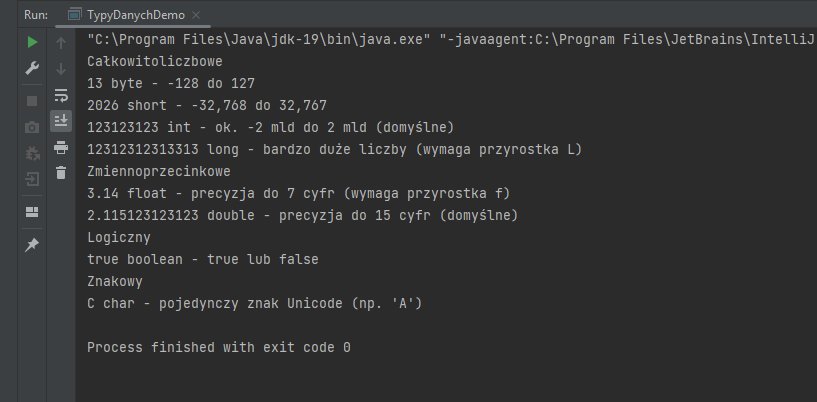
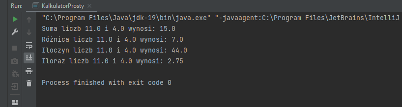
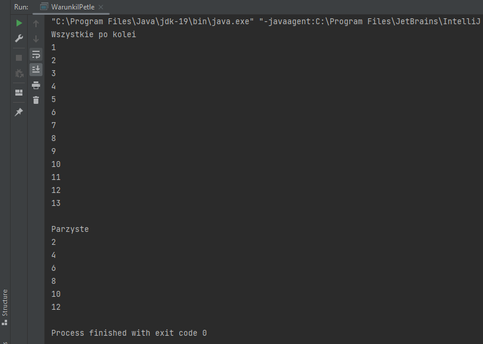
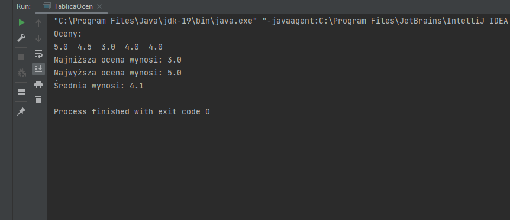
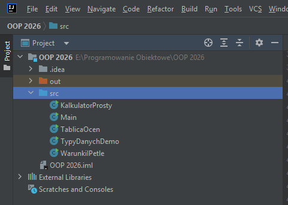

## I. Dokumentacja do lab. nr 1 - "Klasy oraz ich elementy składowe, metody klasy"
## II. Filip Florenc - grupa 1, semestr III
## III. Przedmiot - "Programowanie obiektowe"

## IV. Opis zadania do realizacji
Do zrealizowania były następujące zadania:  
  - opis zadania nr 6 
    >Napisz program TypyDanychDemo, który deklaruje po jednej zmiennej każdego typu prymitywnego i wypisuje ich wartości wraz z opisem.  
  - opis zadania nr 7 
    >Przygotuj program KalkulatorProsty, który dla dwóch liczb całkowitych pokazuje: sumę, różnicę, iloczyn, iloraz całkowity i resztę z dzielenia.  
  - opis zadania nr 8 
    >Napisz program WarunkiIPetle, który dla liczby n wypisze liczby od 1 do n oraz osobno tylko liczby parzyste.
  - opis zadania nr 9 
    >Utwórz program TablicaOcen, który oblicza średnią z tablicy ocen i wypisuje ocenę najwyższą oraz najniższą.

## V. Technologie wykorzystane w zadaniu
  - Java  

## VI. Realizacja zadania
<br>

#### 1. Kod Javy
W zadaniu wykorzystano różne zmienne typu prymitywnego, operatory arytmetyczne, pętle, warunki oraz tablice.

Kod wykorzystany do rozwiązania zadania (zadań):  

### Zadanie 6 

```java
    public class TypyDanychDemo {
    public static void main(String[] args)
    {
        byte bajt = 13;
        short rok = 2026;
        int saldo = 123123123;
        long duze = 12312312313313L;
        float f = 3.14f;
        double przecinek = 2.115123123123;
        boolean prawda = true;
        char litera = 'C';

        System.out.println("Całkowitoliczbowe");
        System.out.println(bajt + " byte - -128 do 127");
        System.out.println(rok + " short - -32,768 do 32,767");
        System.out.println(saldo + " int - ok. -2 mld do 2 mld (domyślne)");
        System.out.println(duze + " long - bardzo duże liczby (wymaga przyrostka L)");
        System.out.println("Zmiennoprzecinkowe");
        System.out.println(f + " float - precyzja do 7 cyfr (wymaga przyrostka f)");
        System.out.println(przecinek + " double - precyzja do 15 cyfr (domyślne)");
        System.out.println("Logiczny");
        System.out.println(prawda + " boolean - true lub false");
        System.out.println("Znakowy");
        System.out.println(litera + " char - pojedynczy znak Unicode (np. 'A')");
    }
}
```
### Zadanie 7
```java
import java.util.Scanner;
public class KalkulatorProsty {
    public static void main(String[] args) {

        double a = 11;
        double b = 4;

        double suma = a+b;
        double roznica = a-b;
        double iloczyn = a*b;
        double iloraz = a/b;

        System.out.println("Suma liczb "+a+" i "+b+" wynosi: "+suma);
        System.out.println("Różnica liczb "+a+" i "+b+" wynosi: "+roznica);
        System.out.println("Iloczyn liczb "+a+" i "+b+" wynosi: "+iloczyn);
        System.out.println("Iloraz liczb "+a+" i "+b+" wynosi: "+iloraz);
    }
}
```
### Zadanie 8
```java
public class WarunkiIPetle {
    public static void main(String[] args) {
        int n = 13;
        int i = 1;
        System.out.println("Wszystkie po kolei");
        for(int ii=1; ii<=n; ii++)
        {
            System.out.println(ii);
        }
        System.out.println("");
        System.out.println("Parzyste");
        while (i<=n)
        {
            if(i%2==0)
            {
                System.out.println(i);
                i+=2;
            }
            else
            {
                i++;
            }
        }
    }
}
```
### Zadanie 9
```java
public class TablicaOcen {
    public static void main(String[] args) {
        double[] oceny = {5, 4.5, 3, 4, 4};
        double max = oceny[0];
        double min = oceny[0];;
        double avg = 0;
        System.out.println("Oceny: ");
        for (int i = 0; i < oceny.length; i++) {
            System.out.print(oceny[i]+"  ");
            avg=avg+oceny[i];
            if(oceny[i]>max)
            {
                max = oceny[i];
            }
            if(oceny[i]<min)
            {
                min = oceny[i];
            }

        }
        System.out.println(" ");
        System.out.println("Najniższa ocena wynosi: "+min);
        System.out.println("Najwyższa ocena wynosi: "+max);
        avg=avg/ oceny.length;
        System.out.println("Średnia wynosi: "+avg);
    }
}
```

#### 2. Zrzuty ekranu pokazujące wynik działania aplikacji/skryptu:  
### Zadanie 6

### Zadanie 7

### Zadanie 8

### Zadanie 9


#### 2a. Struktura projektu/programu:  


<br>

## III. Dodatkowe informacje o zadaniu
**Markdown** jest prostym w użyciu narzędziem, pozwalającym na sprawne wykonanie dokumentacji.